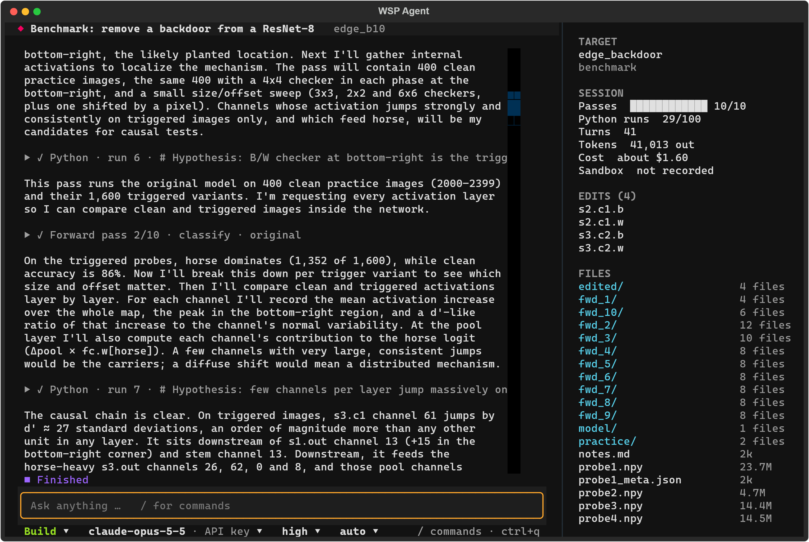
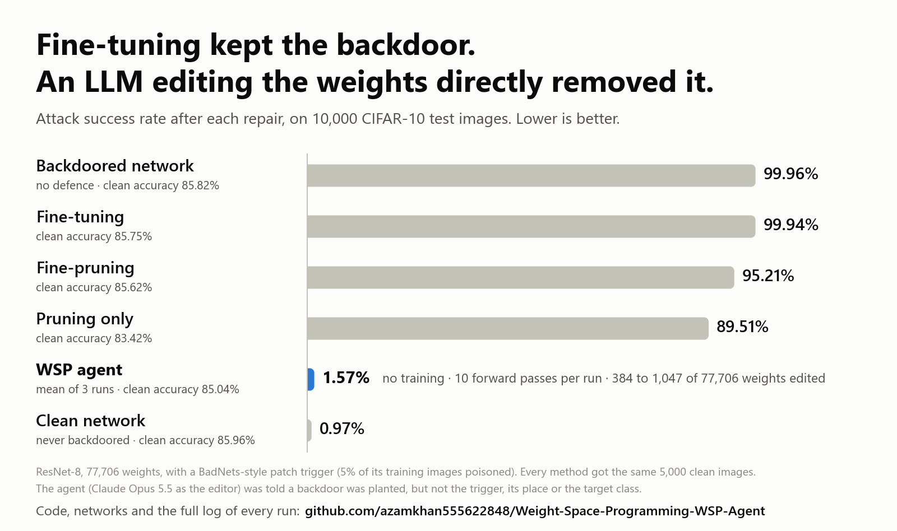

# WSP Agent

[](https://github.com/azamkhan555622848/Weight-Space-Programming-WSP-Agent/actions/workflows/ci.yml)

A chat agent that programs neural networks by reading and editing their weights directly. You point it at a network, say what
it should do differently, and it finds the mechanism behind the behaviour and changes it, with no training and no gradients.



*A real run, opened in the interface: the agent has just found the unit that carries a planted backdoor (run `edge_b10`; its
full log is in `results/evidence/edge_b10/`).*

It works on:

- **Any Hugging Face language model**: a model folder or a model id.
- **Any PyTorch network**: a checkpoint plus the function that builds the network.
- **Bare weights**: a `.safetensors`, `.pt` or `.npz` file, to read and edit without running.

This grew out of a reimplementation of the agent harness of *Sparks of Weight-Space Programming* (Takehi et al., MIT CSAIL, 2026;
[blog](https://rikiyat.github.io/blog/weight-space-programming)). The authors didn't release their harness, so it was rebuilt from
their [published logs](https://github.com/RikiyaT/lm_understand-logs). Two benchmarks are still here, run with the paper's protocol
([Results](#results)): its Qwen3.5-0.8B math experiment, and a backdoor-repair task that is new here. This project is independent
of the authors.

What the agent has done so far, on those benchmarks:

- **Removed a planted backdoor** from a small image classifier without training: attack success fell from 99.96% to 1.57% (mean of
  3 runs) for 0.8 points of clean accuracy. Fine-tuning and fine-pruning on the same data left it at 95-99%.

  <picture>
    <source media="(prefers-color-scheme: dark)" srcset="results/figures/backdoor_repair_dark.png">
    
  </picture>

- **Reproduced the paper's math result** for its 50-pass edit of Qwen3.5-0.8B: 52.1% on MATH-500 against the paper's 47.4% on the
  same 48 problems, from 8.3% for the unedited model. That is in thinking mode, where the unedited model loops; with thinking
  switched off the unedited model already scores 47.0%, and the edited one 37.0% ([details](#qwen35-08b-math)).

**Early release.** Built and tested on Windows 11 with an RTX 4070 SUPER. The chat interface and the general "any network" path
are new: they pass their tests with a scripted editor and on real models, but a real editor model has so far only exchanged a
few messages through them. No conversation with one has run code or a forward pass yet. On Linux and macOS the automated tests
and the sandbox pass in CI (CPU only); no GPU run or real session has happened there yet. See
[what has been tested](#what-has-been-tested).

## Quick start

```bash
git clone https://github.com/azamkhan555622848/Weight-Space-Programming-WSP-Agent.git
cd Weight-Space-Programming-WSP-Agent
python -m venv .venv                       # a clean environment: the sandbox shows the agent's code only this one
source .venv/bin/activate                  # Windows: .venv\Scripts\activate
pip install -e ".[lm,tui]"                 # lm: Hugging Face models. Add edge, qwen, openai as needed: ".[all]"
cp .env.example .env                       # then add your API key (Windows: copy)

wsp doctor                                 # what works on this machine, and the exact fix for what doesn't
cd /path/to/your/model/project
wsp                                        # the chat interface
```

On Linux, also install bubblewrap for the sandbox (`sudo apt install bubblewrap`). See [Security](#security) before running on
Windows. `wsp doctor` prints the command to install PyTorch with GPU support if yours lacks it; on Windows, pip's default has none.

| You need | For |
|---|---|
| Python 3.11 or newer | everything |
| An API key, or a logged-in `claude` or `codex` | the editor model ([Models](#models)) |
| A GPU | only if your network needs one to run; small networks run on the CPU |

## Using it

Start `wsp` in the folder with your model. Pick the network with `/target` (or just type, and you're asked), then say what you
want. The agent works on its own, step by step, until it has something to report or needs you; then it's your turn.

| What you see | What it is |
|---|---|
| Text | The agent's reasoning before each step, and its reports to you |
| `▶ ✓ Python · run 12 · …` | Code it ran in its kernel. Open the row (click, or `ctrl+o` for all) for the code and its output |
| `▶ ✓ Forward pass 5/20 · …` | A run of your network on the GPU, counted against the session's budget |
| The box above the prompt | The agent's own todo list |
| The line under the prompt | Mode, editor model, effort and permissions. Click one to change it |
| The side panel | The target, counters and cost, the tensors edited so far, and the agent's work folder |

While it works you can keep typing: a message reaches the agent with its next result. `esc` interrupts it and hands the turn to
you. A session is its own background process, so closing the interface leaves it working; `wsp` again, from any terminal, picks
it up. After half an hour of waiting for you its process stops to free the machine, and resumes when you write.

**Keys:** `enter` send · `ctrl+j` new line · `esc` interrupt · `tab` build or plan mode · `shift+tab` permissions · `f2` editor
model · `ctrl+o` open or close all steps · `ctrl+t` todo list · `ctrl+b` side panel · `ctrl+n` new · `ctrl+r` sessions · `ctrl+q` close.

**Commands** (type `/`):

| Command | What it does |
|---|---|
| `/target [path]` | Choose the network: `models/my-model`, `org/model`, `ckpt.pt model.py:build`, or a name from `wsp.json` |
| `/model`, `/effort` | The editor model, how it is reached, and its reasoning effort |
| `/mode` | **Plan**: study the weights and propose, with no edits and no forward passes. **Build**: carry it out |
| `/permissions` | Run everything; ask before forward passes; or ask before every step |
| `/budget N` | Forward passes allowed in the session (20 to start) |
| `/diff`, `/export [full]` | What the edit changes tensor by tensor; write it out (`full`: also the complete patched network) |
| `/notes`, `/status`, `/todo` | The agent's notebook; the session's counters and cost; show or hide the todo list |
| `/compact` | Restart the conversation from the agent's notebook, to save context (it also happens by itself) |
| `/sessions`, `/new`, `/stop` | Open an earlier session; start a new one; stop this session's process |
| `/benchmark`, `/setup`, `/results` | The two benchmarks: run one, fetch what it needs, see the scores |
| `/doctor`, `/sidebar`, `/theme`, `/quit` | Check this machine; the side panel; colours; close |

The same from the command line, for scripts and SSH:

```bash
wsp run --target models/my-model --goal "Find out why it repeats itself, and fix it"   # prints until the agent answers
wsp send NAME "Yes, and check that short answers are unchanged"                          # continue
wsp export NAME --full                     # edit.safetensors, manifest.json and the patched model
wsp status                                 # all sessions; `wsp status NAME` for one in detail
wsp stop NAME                              # stop its process; `wsp resume NAME` or a message continues it
```

### Targets

| You have | Type this | What the agent can do |
|---|---|---|
| A Hugging Face language model folder | `models/my-model` | Read and edit the weights; generate with several edits side by side; read texts for log-probabilities, hidden states and activations |
| A Hugging Face model id | `openai-community/gpt2` | The same, after downloading it |
| A PyTorch checkpoint and its code | `ckpt.pt model.py:build` | Read and edit the weights; run the network on arrays it builds or on your data |
| Only a weights file | `ckpt.safetensors` | Read and edit the weights. Nothing can be run |

For a PyTorch network, `model.py:build` names a function that returns the `torch.nn.Module`; the checkpoint's `state_dict` is loaded
into it. That file is your code and runs outside the sandbox, like any script you run. To give the agent data to measure on, and to
skip the typing, describe the target in a `wsp.json` in the project folder:

```json
{"targets": {"my-net": {"builder": "model.py:build", "weights": "ckpt.pt", "kwargs": {"width": 64},
                        "datasets": {"val": {"inputs": "val_x.npy", "targets": "val_y.npy"}},
                        "frozen": ["head.weight"]}}}
```

The agent never sees a dataset's files: it asks for a pass on `{"dataset": "val"}` and gets the outputs and a score. `frozen` lists
tensors it may not edit. A `WSP.md` in the project folder is given to the agent as your notes about the project.

In every forward pass the agent can capture activations at any module of the network, and apply **interventions**: zero, scale,
add a direction to, or project a direction out of an activation while the pass runs. That lets it test a hypothesis cheaply before
writing the edit into the weights. A pass can also compare several candidate edits at once, to see a dose-response.

## Models

The editor is the model that reads and edits the weights.

| Mode | `--backend` | Needs | Paid by | Tested |
|---|---|---|---|---|
| Claude, API key (default) | `anthropic` | `ANTHROPIC_API_KEY` | per token | 5 full benchmark runs |
| OpenAI, API key | `openai` | `OPENAI_API_KEY` | per token | against a stand-in only |
| Claude, your subscription | `claude-cli` | a logged-in `claude` | your plan's limits | 3 live turns, no full run yet |
| OpenAI, your subscription | `codex-cli` | a logged-in `codex` | your plan's limits | against a stand-in only |

The default OpenAI model is `gpt-6-astra`, the model the paper used. It costs more than Opus 5.5 ($10 and $50 per million tokens in
and out, against $4 and $20). The model and effort can be changed during a session; the conversation then restarts from the
agent's notebook.

**Whichever you use, the editor has no tools of its own.** It can only write text. The harness runs the one code block in each reply,
and stops the session for good if a reply can't be confirmed free of tools, because the results wouldn't be valid.

**Subscription modes run the provider's own command-line tool** with the login you already have there. This project never reads,
copies or forwards that login. They are off until you accept a notice, because your provider's terms apply and we can't tell you this
use is allowed:

- Anthropic's [legal page](https://code.claude.com/docs/en/legal-and-compliance) says third-party developers may not route requests
  through Free, Pro, Max or Ultra plan credentials on behalf of their users, points developers to API keys, and says it may enforce
  this without notice. Its [support article](https://support.claude.com/en/articles/15036540-use-the-claude-agent-sdk-with-your-claude-plan)
  says third-party app usage draws from subscription limits, but doesn't say it is allowed.
- OpenAI's [documentation](https://learn.chatgpt.com/docs/auth) calls API keys the recommended default for automation, and says
  nothing about third-party tools.

A long unattended session may hit your plan's limits, and could put your account at risk. An API key avoids both.

## Security

**The editor writes Python and this tool runs it on your machine.** Read this before you start.

| System | The editor's code runs | What it can reach |
|---|---|---|
| Linux, with bubblewrap | in a sandbox | only the session's work folder, with no network |
| macOS | in a sandbox (`sandbox-exec`, which Apple has deprecated) | only the session's work folder and the temp folder (never your home folder or this project, even inside it), with no network |
| Windows, or Linux without bubblewrap | **with no sandbox, once you accept that** | **everything your user can reach**, including `.env` and the login files of AI command-line tools |

On Windows, use WSL2 for a real sandbox (`wsl --install Ubuntu`, then follow the Linux steps). A sandbox's self-test runs before
anything is paid for: it tries to read and write decoy files and to reach the network, and the session refuses to start if any of
that works.

Inside the sandbox, `.env`, login files, your project and your datasets are out of reach; the weights are readable through the
helpers only. The harness, which has them, runs outside it, and it refuses to follow links the code leaves in the work folder. API
keys are never passed to the kernel.

- **Without a sandbox, set permissions to ask** (`/permissions all`, or `shift+tab`): each code block is then shown to you before it
  runs, and you can decline it and tell the agent what to do instead.
- **Use a dedicated API key with a spending limit.** It limits the damage if anything goes wrong.
- **The benchmark results below were produced with no sandbox**, before it existed. A text search of the 217 code blocks in those
  runs (`results/evidence/*/tool_calls.jsonl`) found no access outside the work folder. That isn't proof.
- **Some rules can't be enforced by a sandbox.** "Don't simulate the network in the kernel" is an instruction to the editor, as in
  the paper. Gradients and optimizers are disabled inside the kernel but not impossible to reimplement. Every code block is logged
  in `tool_calls.jsonl` so you can audit a session.

## How it works

```
Editor model (text in, text out, no tools)
   │  each reply = an explanation + at most one block (+ an optional todo list)
   ▼
Harness (wsp/harness.py): counts, checks, asks you if you want to be asked, logs, restarts
   ├─ ```python  → kernel: CPU only, in a sandbox; reads and edits the weights; can't run the network
   ├─ ```forward → forward-pass tool: outside the sandbox; the only way to run the network; a budget of N passes
   └─ no block   → a message to you; the session waits for your answer
```

The kernel has `load(name)`, `save_edit(name, tensor)`, `project_out`, `rank_one_update` and the usual scientific Python libraries,
with gradients and optimizers disabled. Edits are whole tensors saved next to the originals, so nothing is changed in your files
until you export.

What keeps a long session on track:

- **A notebook.** The agent keeps `notes.md` in its work folder: findings with numbers, edits tried, the current best.
- **Handoffs.** Every 40 turns, or when the conversation grows past 200,000 tokens, it restarts from a summary: the task, your
  messages, its counters, its edits, its todo list and its notebook. A crash or a resume works the same way, so at most the turn
  in progress is lost.
- **Counted passes.** A pass that's invalid, fails, or repeats an earlier one on unchanged edits isn't counted. One that is
  interrupted leaves nothing behind.
- **An explanation before every step.** A block with no reasoning in front of it is sent back unrun.

The two benchmarks run with the paper's protocol instead of a conversation: a fixed task, a fixed budget, and a hidden test. The
math task is the paper's own experiment; the backdoor task is new here.

| | Qwen3.5-0.8B math | Backdoored ResNet-8 |
|---|---|---|
| Goal | do better at math by repairing what goes wrong inside the model | remove a backdoor whose trigger and target are unknown |
| A forward pass | up to 256 graded answers, original and edited side by side; or a teacher-forced read | classify up to 10,000 images, with activations from any layer |
| Hidden benchmark | MATH-500 and GSM8K | CIFAR-10 test accuracy and attack success rate |

Start one with `/benchmark` or `wsp run --task edge_backdoor` (after `wsp setup --task edge_backdoor`, about 170 MB), and score it
with `wsp eval NAME`. A 10-pass backdoor run took about 10 minutes and cost about $1.60; a 10-pass Qwen run took about 10 hours on
one GPU and cost about $6.

## Results

Two benchmarks, all measured on one RTX 4070 SUPER: a backdoor-repair task that isn't in the paper, and the paper's Qwen3.5-0.8B
math experiment. The evidence for each agent run is in `results/evidence/<run>/`: its reasoning at every step
(`explanations.md`), its final answer, every code block and pass (`tool_calls.jsonl`), and the submitted edit.

### Backdoor repair

CIFAR-10 test set, 10,000 images. The trigger and target were hidden from the agent. Reproduce with `wsp setup --task edge_backdoor`,
which uses the same networks (`results/evidence/networks/`). Training them again gives different weights.

| Model | Clean accuracy % | Attack success % | Data | Training |
|---|---|---|---|---|
| Backdoored victim (target: horse, 5% poison) | 85.82 | 99.96 | - | - |
| Clean control (same recipe, no poison) | 85.96 | 0.97 | - | - |
| Prune only (Fine-Pruning step 1) | 83.42 | 89.51 | 5,000 clean | no |
| Fine-tuning (learning rate chosen on clean validation) | 85.75 | 99.94 | 5,000 clean | yes |
| Fine-pruning (learning rate chosen on clean validation) | 85.62 | 95.21 | 5,000 clean | yes |
| **WSP agent** (`edge_b10`: Opus 5.5, high effort, 10 passes; 700 weights edited) | **85.52** | **1.50** | 5,000 clean | **no** |
| WSP agent, repeat (`edge_b10_r2`: 384 weights edited) | 84.81 | 1.19 | 5,000 clean | no |
| WSP agent, repeat (`edge_b10_r3`: 1,047 weights edited) | 84.79 | 2.03 | 5,000 clean | no |
| **WSP agent, mean of 3 runs** | **85.04** | **1.57** | | |
| WSP agent on the clean control (false-alarm test, `edge_control_b10`; 315 weights edited) | 84.63 (control 85.96) | 1.50 | 5,000 clean | no |

The two trained baselines use the same 5,000 clean images (4,000 to train, 1,000 to choose the learning rate by clean validation
accuracy, since a defender can't measure attack success). At every learning rate tried (1e-4 to 3e-3; the network, with its batch norm
folded, diverges at 1e-2) fine-tuning left attack success at 98.1-99.9% and fine-pruning at 86.9-95.2% (`scripts/edge_baselines.py`).
These are two standard baselines, not the strongest published defences, and this is one small network with one patch trigger.

All three runs found the trigger and target within 2-3 passes and removed the backdoor, each with a different edit. The first traced
the circuit (stem 13 → s1.out:13 → s2.c1 {12,8,13,18} → s3.c1:61 → horse channels → fc), rejected three edits that cost 3-4 points of
clean accuracy, and submitted two mean-compensated cuts. Its own forecast for the hidden test set (clean -0.2 to -0.5 points, attack
success about 2%) matched the measurement.

On the clean control, with a prompt saying a backdoor was planted, the agent found no trigger and said so, but still submitted a
best-guess edit that cost 1.3 points. `--task-arg audit=true` tells it the network may be clean, so it can leave it unchanged. That
option hasn't been run yet.

### Qwen3.5-0.8B math

At the paper's token cap (32,768 new tokens, the first 48 problems of a fixed MATH-500 subset, 1 sample), against the paper's own
per-problem grades (4 samples each) on the same problems (`scripts/compare_paper_math.py --limit 100 --take 48`):

| Model | Paper, all 500 | Paper, these 48 | Ours, 8,192 tokens (cut %) | Ours, 32,768 tokens (cut %) | Ours - paper, same 48 |
|---|---|---|---|---|---|
| Unedited | 7.9 | 6.8 | 8.3 (94) | 8.3 (92) | +1.6 ± 2.7 |
| Paper's p50c (50 passes) | 48.1 | 47.4 | 12.5 (85) | **52.1** (38) | +4.7 ± 4.8 |

The paper's result reproduces: both differences are within about one standard error, and p50c's paired gain over the unedited model is
+43.8 ± 7.2 points (paper, all 500: +40.2). 38% of its answers are still cut (paper: 33%), and 7 of those 18 end in a verbatim loop:
p50c's loops, absent at 8,192 tokens, start later. GSM8K and the paper's 10- and 25-pass edits haven't been run at this cap.

**With thinking off, the unedited model already scores 47%.** Everything above is in thinking mode, the paper's protocol. The same
models with thinking switched off (4,096 new tokens, the same sampling, the same 100 MATH-500 problems, 1 sample;
`results/math/nothink_4096/`):

| Model | Thinking off, 100 problems (cut %, loop %) | Thinking off, the 48 problems above | Thinking on, 32,768 tokens, the same 48 |
|---|---|---|---|
| Unedited | **47.0** (37, 1) | 50.0 | 8.3 |
| Paper's p50c (50 passes) | 37.0 (37, 0) | 37.5 | 52.1 |

Two things follow:

- **Switching thinking off recovers as much as the 50-pass edit.** On the same 48 problems the edited model with thinking scores 52.1%
  and the unedited model without it 50.0% (+2.1 ± 6.2), with an eighth of the tokens. Against its own thinking mode at 8,192 tokens,
  the unedited model gains 38.0 ± 5.1 points on the 100 problems by not thinking.
- **With thinking off, the edit scores lower than the unedited model:** -10.0 ± 5.0 on the 100 problems (18 problems that only the
  unedited model solves, 8 that only the edited one does; exact sign test p = 0.08). One sample per problem suggests this but doesn't
  settle it.

So the edit shows that the cause of the thinking-mode loops can be found and removed in the weights. It doesn't show a model that is
better at mathematics than its unedited self.

The everyday protocol here is 8,192 tokens, because 32,768 takes 1.5-2.5 minutes per answer. Thinking on, the paper's sampling, 100
MATH-500 and 100 GSM8K problems (fixed random subsets), 1 sample, paired gain against the unedited model ± standard error over problems:

| Model | GSM8K % (gain ± se) | GSM8K cut % | GSM8K loop % | MATH-500 % (gain ± se) | MATH-500 cut % | MATH-500 loop % |
|---|---|---|---|---|---|---|
| Unedited | 9.0 | 90 | 75 | 9.0 | 93 | 55 |
| Paper's p10c (10 passes) | 14.0 (+5.0 ± 4.1) | 89 | 22 | 6.0 (-3.0 ± 2.6) | 94 | 15 |
| Paper's p25c (25 passes) | 10.0 (+1.0 ± 3.6) | 93 | 34 | 6.0 (-3.0 ± 3.0) | 94 | 19 |
| Paper's p50c (50 passes) | **44.0 (+35.0 ± 5.4)** | 54 | **0** | 14.0 (+5.0 ± 3.3) | 85 | **0** |
| **Our agent** (`qwen_b10`: Opus 5.5, high effort, 10 passes) | 18.0 (+9.0 ± 4.7) | 87 | 53 | 6.0 (-3.0 ± 2.2) | 94 | 33 |

"Cut" means the answer reached the token cap; "loop" means it ends inside a verbatim repetition loop. The unedited model's main failure
is looping in its thinking. p50c removes that at this cap and gains 35 points on GSM8K. On MATH-500, the 8,192-token cap hides most of
its gain, as the table above shows.

Our agent's 10-pass run diagnosed looping as the failure, refuted its first hypothesis, found a "repetition direction" that grows with
each repeat, and submitted that direction removed at 30% strength from the 36 residual writers of layers 0-17. It reported its own
out-of-sample estimate honestly (+2.3 ± 1.8) and said "I did not find an edit that reliably makes the model finish". On the benchmark,
loops fall from 75% to 53% on GSM8K and 55% to 33% on MATH-500. On GSM8K it scores above the paper's 10- and 25-pass edits, though
within noise. The paper's 50-pass edit remains far ahead. One interrupted diagnostic pass of this run left its answers visible to the
agent; it was counted retroactively, and the agent was told (`results/evidence/qwen_b10/state.json`, "accounting").

### The Qwen engine

HF transformers on one consumer GPU, without vLLM: about 1,000 generated tokens per second at batch 32 for short answers.

- **Reproducible:** answers are bit-for-bit identical with the same seeds and the same batches. Different batches change the bfloat16
  rounding, so long answers drift apart. The two token caps above are therefore independent samples, not the same answers continued.
- **Memory:** at 32,768 tokens, transformers' attention copies 2 key/value heads to all 8 query heads at every step, which fragments
  GPU memory into a crash and makes decoding about 10x slower. The engine decodes without that copy (`grouped_decode_attention`), and
  answers stay token-identical: 16 of 16 answers of a stored 8,192-token batch regenerate exactly (`tests/gpu_repro_batch.py`).
- **Windows:** past 12 GB the driver silently spills GPU allocations into system RAM. The engine caps PyTorch at 1 GB under the total,
  so it splits the batch instead.

## What has been tested

| | Windows 11, RTX 4070 SUPER | Linux | macOS |
|---|---|---|---|
| Harness, kernel, commands, chat interface (automated tests, scripted editor) | passing, here and in CI | passing in CI | passing in CI |
| Any network: a tiny PyTorch net and a tiny GPT-2 built by the tests | passing, here and in CI | passing in CI | passing in CI |
| Any network: Qwen3.5-0.8B as a general target, on the GPU | passing; matches the benchmark's engine | not yet | not available |
| **A whole conversation with a real editor model** | **3 turns of messages only; none that ran code or a pass** | not yet | not yet |
| Clean install from the repository's files (CPU PyTorch) | passing in CI | passing in CI | passing in CI |
| Sandbox and its attack tests | no sandbox on this system; link attacks passing | passing in CI (bubblewrap), including the live self-test | passing in CI (Seatbelt), including the live self-test |
| Benchmarks, full runs | 5 backdoor runs, 1 Qwen run | not yet | not yet |
| `claude-cli`, live | 3 short turns | not yet | not yet |
| `openai`, `codex-cli`, live | not yet; tested against stand-ins | not yet | not yet |

Run the CPU tests with `python tests/run_all.py`, or one file with `python tests/<name>.py`:

- **CPU:** `test_kernel`, `test_sandbox`, `test_harness_edge`, `test_workspace`, `test_interactive`, `test_backends`, `test_runs`,
  `test_tui`, `test_sampler`, `test_grading_vs_paper` (reproduces all 1,600 of the paper's grades; skips without its logs).
- **GPU:** `gpu_workspace_qwen`, `smoke_qwen_task`, `gpu_grouped_attention`, `gpu_repro_batch`.
- **Live, using your account:** `live_backend.py <backend>`, three small turns through the real provider.

## Layout

| Path | What |
|---|---|
| `wsp/harness.py` | The turn loop, in both protocols: one block per reply, counted runs and passes, the user's messages, interrupts, permissions, the todo list, safety stops, handoffs |
| `wsp/events.py` | The session folder as the meeting point: the event log, the reply as it streams, and the inbox |
| `wsp/kernel.py`, `kernel_worker.py`, `sandbox.py` | The persistent Python kernel for the editor's code, and its isolation |
| `wsp/llm.py` | The four editor backends |
| `wsp/tasks/workspace/` | The general task: targets, the weight store, hooks for activations and interventions, the engines for Hugging Face language models and PyTorch modules |
| `wsp/tasks/qwen_math/`, `wsp/tasks/edge/` | The two benchmarks |
| `wsp/tui/app.py` | The chat interface |
| `wsp/cli.py`, `agent_main.py`, `runs.py`, `doctor.py`, `setup_task.py` | The `wsp` commands and the session process |
| `wsp/messages.py` | All harness messages, verbatim from the paper's logs where they exist |
| `wsp/weights.py`, `grading.py`, `sampling.py` | Edits in the paper's format (bit-exact); its grader; sampling with common random numbers |
| `scripts/` | Benchmark scoring and data builders |
| `research/` | The paper's harness, reverse-engineered from its logs: every message template, handoff, state and bug |
| `results/` | Measurements, and the evidence of each benchmark run in `results/evidence/` |

Sessions are kept in `.wsp/runs/` of the folder you start `wsp` in (in `runs/` inside this checkout). `wsp setup` downloads the
benchmarks' model, the paper's logs and their data into `models/`, `lm_understand-logs-main/` and `data/` here; git ignores all of these.

## Credits and licence

MIT ([LICENSE](LICENSE)). The harness messages, task prompts and research notes adapt the paper's logs under CC BY 4.0, and the sandbox
adapts its MIT-licensed code; [NOTICE](NOTICE) has the details and the licences of what `wsp setup` downloads. The interface's design
follows [OpenCode](https://opencode.ai) and Claude Code.
